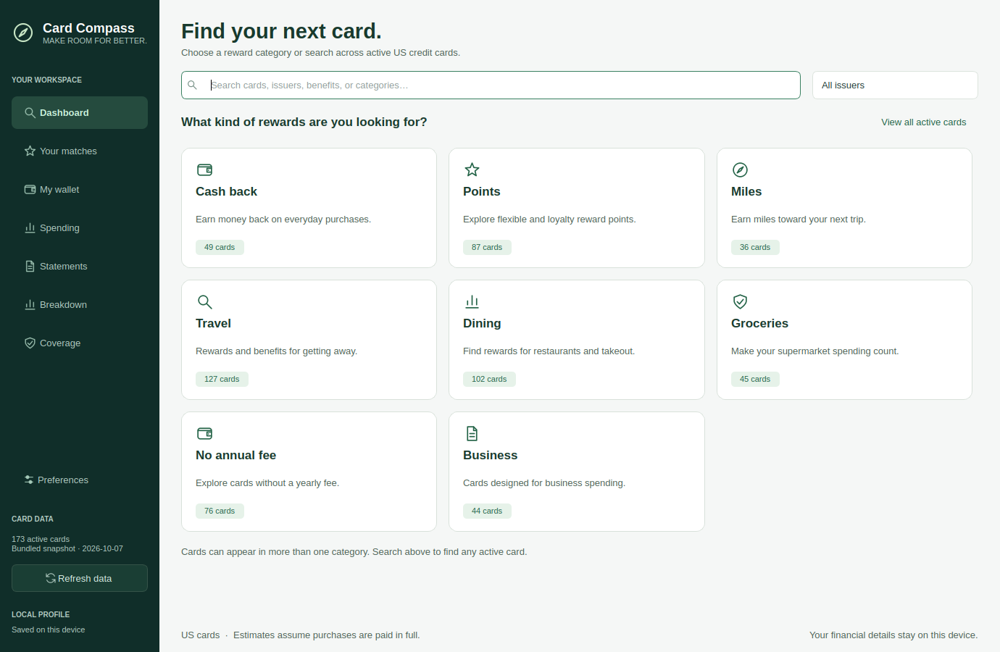

# Finance Compass

A native Python/Qt financial workspace with a shared light/dark theme across Overview, budgeting, investments, credit cards, charts, and dialogs. Existing wallets and statement history stay in the original profile directory.

## Run the workspace

```sh
python -m pip install -e .
python -m card_compass
```

The `finance-compass` and `card-compass` commands launch the same app. All runtime features use Python and Qt. No Node.js build, web server, or embedded browser is required. The **Dark mode** button in the header or sidebar switches the whole application immediately and saves the selection in `profile.json`.

[Modular investment blocks in dark mode](docs/dashboard-blocks-dark.png) · [Credit cards in dark mode](docs/native-cards-dark.png) (synthetic sample data).

## First ten minutes

Open **Overview → Build my first plan**. Enter the monthly take-home income, rent, grocery budget and transport budget you know; skip the rest. The app creates a repeating plan locally. Use **Manage income** to change an existing source, and the buttons beside income and bills to mark money received or paid. **Category budgets** and **Spending chart** keep the working page compact. Cards and investments are optional next steps. Open **Investments → Watchlists and positions** to add a ticker or record a trade; **Demo preview** lets you explore with clearly labeled sample data. **Dashboard tools → How to arrange widgets** explains layout controls inside the app.

Overview and Budget share a saved month selection: choose a month from the dropdown, type the year, or use the visible previous/next arrows. The Credit cards sidebar group expands and collapses. Dark mode, Card preferences and **Backup & restore** remain in the fixed sidebar footer.

**Backup & restore → Back up all my data** saves budgets, income, wallet settings, statement history, investment trades, dashboards and notes to a ZIP file. Restoring validates the archive, asks before replacing data, keeps a recovery copy of the previous data and reopens the workspace. Market caches and downloaded card images are not part of the backup. **Investments → Tools → Export investments** is a separate investment-only export.

## Native investments

**Investments** shares the application's navigation, surfaces, controls, and theme. It includes:

- Independent widgets on a 12-column layout with separate heights. Turn on **Edit layout**, then drag any widget header: a lifted widget follows the pointer and a blue placeholder shows the snapped destination. Drop beside another widget to create columns, or above/below it to insert. Neighbors move out of the way; the page extent stays fixed during the gesture. Resize from the right edge, bottom edge, or corner; double-click a handle to fit content. **Dashboard tools → Dashboard settings** controls gap closing, free placement, density, spacing and reduced motion. Turn edit mode off to use tables and notes.
- **Add widget** opens a searchable gallery with categories, live previews and size hints. Add to the first free spot, or drag from the gallery onto the grid. The **⋯** menu configures, renames, duplicates, moves/copies to another dashboard, refreshes, expands, locks, or removes a block. Removal offers an Undo toast. **Undo/Redo**, Ctrl/Cmd+Z, and Ctrl/Cmd+Shift+Z cover layout and configuration changes throughout the session. Keyboard arranging uses Space/Enter to pick up/drop, arrows to move, Shift+arrows to resize, and Escape to cancel.
- Create, rename, duplicate, reorder and delete custom dashboards. **Dashboard tools** includes reset, JSON import/export, saved templates and Investment overview / Trader view / Research view starter templates. The four primary pages remain available. Layouts save independently for each dashboard and viewport breakpoint; **Saved / Saving… / Failed – retry** reports persistence status. The [rebuild notes and acceptance checks](docs/dashboard-rebuild.md) describe the native implementation.
- Double-click a stock to open a separate, closable research tab while retaining **Home dashboard**. Reopening a ticker selects its existing tab. A visible scope label states whether research changes affect the shared stock layout or **Customize only this stock**. The latter keeps widgets and geometry independent; notes are saved per stock. Tabs can be reordered.
- **View settings** controls summary tile visibility, table columns, and row height. Drag table column headers to reorder them; these choices are saved with the workspace.
- Multiple watchlists and a shared USD trade ledger. Buys and sells include fractional shares, execution prices, dates, and fees. Positions use Decimal FIFO accounting; changes that would leave subsequent sales without enough shares are rejected. Removing a ticker or watchlist retains trades.
- A hypothetical FIFO sale dialog and the original limited 2026 federal/NC tax estimator. Configure income and deduction assumptions from Trade history, Tools, or directly from the sale dialog without losing the sale inputs. Tax estimates are withheld for loss scenarios or histories and unsupported years. This is a planning estimate; no broker orders are placed.
- Market news with eleven stock sectors plus market/economy news, headline search, and separately saved research widgets and notes for each sector. Headlines and notes are independent widgets: use **Edit layout** to move or resize either, including the headlines window. Sector tags use headline keywords and are not publisher classifications.

Use **Refresh market data** for public Yahoo Finance quotes, price history, fundamental metrics, analyst coverage and RSS headlines, CNBC market RSS, and Nasdaq earnings dates. Requests run off the UI thread and never include your personal income, notes, or trades. Public endpoints can be delayed, rate limited, or unavailable. Missing data displays `—`; cached data is marked and not used to value holdings. The portfolio market-value tile excludes unavailable, cached, demo, and non-USD quotes. The tile visibly identifies partial totals and how many positions are priced; **See unpriced positions** explains the missing holdings. **Demo preview** explicitly labels synthetic data; it never values personal positions or prefills trade prices.

Investments save to `investments-workspace.json`; public market data cache is separate in `market-cache.json`, beside the existing profile. The Overview screen shows the remaining investment cost basis and saved card count alongside monthly cash flow. Investment trades do not automatically become budget expenses or income, since funding transfers and realized gains are different from monthly spend.

Use **Tools → Import investments** to bring in a Folio version 1 JSON export. Watchlists, trades, notes, dashboard geometry, stock overrides, and sector pages are preserved. Imports replace investment state after confirmation; budget and card data remain separate. **Tools → Export investments** backs up native investment state in version 2, with layouts for four viewport sizes. Version 1 imports migrate automatically, including unavailable widget types as recoverable placeholders. Existing Folio browser storage is preserved; export that workspace from the original Folio app before importing here. The `stocks/` source is retained as a reference implementation and is not part of the desktop runtime.

## Budget your month

1. Open **Budget & cash flow** and choose a month from the dropdown. **Manage income** lists existing sources with a direct edit action. **Add income** creates a separate repeating source; **Add a bill / expense** records money outside imported card statements. Categories accept custom names.
2. Use **Mark received** or **Mark paid** on a row to include that occurrence in actual cash flow; the action then becomes **Undo received/paid**. New entries can also be marked already received/paid in their dialog. Editing a repeating entry defaults to **This month and future months**, preserving earlier amounts and postings. **This month only** preserves both earlier and later occurrences. **Entire series** requires confirmation. **End after this month** retains earlier history; deleting a series requires confirmation.
3. In **Category budgets**, choose a category, amount and whether it should **Repeat monthly**. Monthly-only budgets override repeating budgets, including an explicit zero. Budgets are independent of credit-card recommendation estimates. **Copy last month…** previews existing and replacement amounts before applying them to this month only.
4. Review expected income, planned outflow, unallocated income and actual cash flow. Pending received/paid items are shown near the totals. Planned outflow uses the larger of each category's budget and scheduled bills, so rent is not counted twice. Actual spending combines paid non-card expenses with imported purchases minus refunds, grouped by transaction date.

**Spending chart** switches between actual and planned expenses. The pie includes positive category totals and savings cash outflows, excludes income and card payments, and omits refund-only categories. Exact amounts appear in **Category budgets**. Overview's **Cards and investments** tab shows investment cost basis and saved cards.

**Credit cards** uses the same sidebar button styling as the other sections; its sub-tabs are indented beneath it.

Do not re-enter imported card purchases as non-card expenses. Credit-card payments are transfers, so do not enter them as expenses. Savings contributions can be tracked as planned cash outflows, but this release does not track savings account balances or calculate net worth. Income is entered as the amount you expect to receive; there is no payroll/tax deduction calculation. Monthly budget targets, cash entries, and posting status live in new tables in `transactions.sqlite3`, using integer cents. All entries remain local.

Build the native desktop distribution:

```sh
python -m PyInstaller --noconfirm FinanceCompass.spec
```

The distribution includes the native investment screens. Build separately on each target operating system.

## Credit-card module

The native credit-card module helps choose your next US credit card on Windows, macOS, and Linux using Python and Qt.

[Preview the desktop workspace](docs/gui-preview.png) (sample wallet and spending).

- Start with reward-category tiles; search cards, benefits, earning categories, annual fees, and published signup offers.
- Add your existing cards to a saved wallet, including manually entered cards.
- Enter monthly spending; Coverage puts your highest spending categories first.
- Import CSV statement exports or BOFA/Amex PDFs, categorize each new merchant once, and reuse your saved choices on later imports.
- See your biggest spending categories and merchants in **Breakdown**, with month/card filters, refunds, and monthly trends.
- Infer coverage from your wallet, or override a category's cash-equivalent rate. Set **0%** for an uncovered category and **Auto** to derive it from cards.
- Compare **additional** annual rewards against your existing wallet, after the new card's fee. Recurring and first-year estimates are separate.
- Refresh the public catalog in the background on every startup. Offline starts use the last successful cache, then the bundled snapshot.

## Run

Install Python 3.10 or newer. From this directory:

```sh
python -m venv .venv
```

Activate the environment:

```sh
# Windows PowerShell
.venv\Scripts\Activate.ps1

# macOS / Linux
source .venv/bin/activate
```

Then:

```sh
python -m pip install -e .
python -m card_compass
```

The installed `card-compass` command also launches the app. Linux requires a desktop session and Qt system libraries; on Ubuntu install `libegl1 libopengl0 libxcb-cursor0 libxkbcommon-x11-0` if Qt reports missing platform libraries. If you prefer not to activate a virtual environment, use `.venv/bin/python` on macOS/Linux or `.venv\Scripts\python.exe` on Windows directly.

## Use

1. Start in **Dashboard**. Choose Cash back, Points, Miles, Travel, Dining, Groceries, No annual fee, or Business to browse a group, or search for any active card across reward categories. **View all active cards** opens the full list; **Dashboard** above the results returns to the tiles. Select a card and click **Add to wallet**. Use **My wallet → Add manually** for cards missing from browsing.
2. In **Spending**, enter monthly purchases in separate buckets. Click **Monthly Spend** to sort highest first; click again for lowest first. Coverage uses your configured target: green meets the target, amber is below it and red means no rewards. Choose **Auto** to show the calculated rate in one dropdown, or **Manual** to enter a rate. Coverage also displays which card to use. **Add a category** includes merchant and travel-portal categories. Move that spending out of other buckets to avoid double counting.
3. Use **Coverage** to see gaps against your adjustable target, initially 2%. Manual coverage entries replace inferred wallet coverage for that category.
4. Compare **Your matches**, which highlights your strongest match and its incremental value. Choose ongoing or first-year sorting, and use **Card preferences** to set your maximum annual fee, point values, coverage target, and bonus assumptions.
5. Adjust point values, selections, and activation in **Card settings**. The default assumption is **1 cent per point/mile across all programs**; change it to your actual redemption values, especially for hotel points.
6. Signup offers are displayed automatically. Enable **Count public signup bonuses** only if you expect to qualify. Only public, unexpired offers with spend requirements your stated spending pace can meet enter the first-year estimate. Alternative offers are compared individually; they are not added together.

The desktop workspace opens to the finance overview. Expand Credit cards for dedicated screens for discovery, matches, wallet, spending, coverage, and preferences. Discovery excludes cards marked discontinued or with unknown availability; existing saved wallet cards remain available for coverage, settings, and statement history. Tile counts update after refresh. Categories overlap and use published reward units, earning categories, fee, variant, and relevant travel benefits. Generic travel insurance alone does not classify a card as a travel card. The issuer filter applies to search results; typing a search clears the selected reward group.

Card details open in a separate window with Overview, Offers, Benefits, and Sources tabs. Select a card and click **Open selected card**, double-click it, or press Enter to open its details; Escape closes the detail window. The interface supports a minimum window size of 1040 × 720. Routine finance tasks fit without whole-page scrolling; longer tables and customizable dashboards scroll within their panels. **Review card assumptions** names affected cards and opens their settings; **How is this calculated?** explains the selected estimate.

Real card artwork appears in browsing results, wallet entries, recommendations, and card details. Images download asynchronously as cards become visible, with at most four concurrent requests. Valid PNG, JPEG, and WebP images are stored in `artwork/` alongside your profile and reused offline. Server ETag/Last-Modified checks avoid downloading unchanged images; changed image references use separate cache files. Catalog refresh allows displayed images to be checked again. Downloads have size/dimension limits and a timeout, and closing the app cancels outstanding image requests. Invalid or unavailable images fall back to the vector illustration. The Sources tab links the catalog's artwork reference; images may depict older card designs.

[Preview the wallet with card artwork](docs/artwork-preview.png) (sample wallet).

List thumbnails use larger 128 × 80 display slots and smooth resampling to the display's physical pixel density, with cached resized images and pixel-aligned drawing. Browsing results show Card and Annual Fee; discontinued cards remain excluded, so there is no separate Availability column.



For cards with one selectable rewards category, **Card settings** uses a searchable dropdown. Choose the category currently set with your issuer and click **Save**; Coverage updates using that selection and restores it when you reopen the app. Multi-category benefits retain checkbox lists. For Bank of America Customized Cash Rewards, choose **Dining** to apply its standing 3% dining rate; separate activation is not required. Its **Online Shopping** option maps to the **Online retail** spending bucket. Coverage displays effective rewards after any shared spending cap, so large spending amounts can show less than the advertised category rate.

## Import statements

1. Add your cards to **My wallet**, then open **Statements → Import CSV or PDF**.
2. For CSVs, confirm the suggested column mappings and select the amount convention: purchases positive, purchases negative, or separate debit/credit columns. Date, description, and amount columns are required; reference, posting date, account, category, and type columns are optional. You can supply the account’s last 4–5 digits if the export omits it.
3. Select the matching wallet card and verify the statement closing date. If the date needs correction, click **Read dates again** before reviewing. CSVs initially infer it from the latest posting date.
4. In **New merchants**, choose a category for each unfamiliar merchant. Repeated purchases are grouped together. You can link a description to an existing merchant and remember the category across all cards, for this issuer, or for this card only.
5. Review the purchases, exclusions, and parsing warnings. A purchase's category can be overridden without changing the merchant's default. Confirm the review and save.
6. Optionally choose **Use imported spending** to preview and replace your monthly spending inputs. Saving a statement alone does not replace them.

Later imports reuse saved merchant choices. Re-imported transactions are skipped by default; explicitly include a flagged duplicate only if it represents another purchase. Identical purchases within one statement retain their separate occurrences. Payments, interest, fees, and reward credits are excluded from spending; merchant refunds reduce their category totals.

Type part of a category name in a category picker to search, then choose a matching suggestion with the keyboard or mouse. Search ignores capitalization and matches words anywhere in the label. This works for statement categories and **Add a category**; Card settings has search fields for its category lists. Unfinished category searches cannot be saved as purchase overrides. Scrolling over dropdowns, dates, and numeric fields does not change their values; use keyboard input or an explicit dropdown selection.

Search descriptions or merchant names and filter Statements by month or card; choose date, amount or merchant sorting. **View selected purchase** shows the full description and its one-off option. Secondary card/one-off columns are optional.

The **Saved merchants** tab lets you change defaults and optionally apply them to past transactions; individual overrides are preserved. **Accounts** lets you correct a linked wallet card. **Imported files** lets you remove an import while retaining merchant choices, then re-import it if needed. Reapply imported spending after changing or removing transactions to update the recommendation inputs.

Monthly spending is calculated separately for each card: category totals divided by the number of distinct imported statement closing months, then added across cards. This is an average of imported statement periods, so import complete statements for the months you want represented. The preview replaces all manual spending buckets after confirmation; coverage settings remain separate.

To keep an unusual purchase, such as a large flight, out of recommendation averages, check **One-off** in import review or **Statements → Transactions**. **Spending → Manage one-off transactions** opens that history table. The setting applies to the individual transaction, persists across restarts, and does not change the merchant's default category. One-off purchases remain in history and Breakdown, and their statement months still count in the averaging denominator. If a one-off purchase is refunded, mark its refund separately.

Choose **Use imported spending** to apply the filtered averages. While those inputs remain based on imports, changing a one-off checkbox automatically updates spending and recommendations. Editing a monthly spending amount switches to manual inputs, which one-off changes preserve; choose **Use imported spending** again to resume imported averages. Category/history edits and import removal show a persistent update action on Statements and Matches when imported recommendation inputs are outdated. Applying the preview clears it; switching to manual inputs clears the imported-input warning. Existing databases automatically gain the one-off field without deleting history.

[Preview spending sorting and coverage colors](docs/spending-preview.png) (synthetic values).

The initial parsers support selectable-text BOFA and Amex layouts based on the supplied examples. Tests use synthetic PDFs; other statement layouts may need adjustments. Scanned PDFs require OCR, which is not included, and password-protected PDFs must be unlocked first. BOFA purchase totals are checked when available. Printed Amex merchant categories are displayed as hints; your choices determine the spending categories. Reference numbers do not determine categories, and these categories do not verify issuer bonus eligibility.

CSV imports work with any wallet card when its export can be mapped to the required columns. Comma, semicolon, and tab delimiters and quoted values are supported; dates use US `MM/DD/YYYY`, `MM/DD/YY`, or ISO `YYYY-MM-DD`, with US dollar amounts. Export one billing period per file for spending averages. Invalid transaction rows stop the import with a row number rather than silently dropping purchases. CSVs have no statement total to reconcile. XLS/XLSX workbooks are not supported; export them as CSV first.

Re-importing the same CSV reuses merchant rules and duplicate checks. PDF and CSV exports may use different descriptions, posting dates, references, or account endings, so duplicate detection across formats is not guaranteed. Review overlapping imports before saving, and remove an earlier import before replacing it with corrected column/sign settings. CSVs without account endings use the selected wallet card as the account identity.

PDFs and CSVs are read locally and are not retained by the app. Extracted transactions, account endings, import metadata, and merchant choices are saved locally in `transactions.sqlite3`.

## Spending breakdown

Open **Breakdown** in the sidebar after importing statements. It shows purchases, refunds, and net spending, with charts for the largest categories and merchants. Tabs list categories, merchants, cards, calendar months and charts. Double-click a group, or use **View purchases in selected group**, to open matching transactions while preserving the period/card filters. Choose a month or card to narrow the results.

Rankings use net spending (purchases minus refunds). The Share column shows the portion of purchases before refunds, so refunds do not create misleading percentages. Payments, fees, interest, transfers, and reward credits are excluded. Uncategorized purchases remain included. Saved merchant aliases group repeat descriptions; individual transaction category overrides remain respected.

These are actual totals from imported transactions, grouped by transaction date, rather than the statement-period averages used for recommendations. Missing months are not estimated and manual spending inputs are not included. The page updates after imports, category/history edits, account reassignment, or import removal. The database location also appears at the bottom of the page.

[Preview the Breakdown page](docs/breakdown-preview.png) (synthetic sample purchases).

## Data and calculation limits

Catalog data comes from [fuermosi777/rewards](https://github.com/fuermosi777/rewards), a public community-maintained database with issuer source links and review dates. Each startup refresh downloads card and bonus JSON and checks Venture Rewards' signup offer directly against Capital One's public page. Other cards remain community-sourced; a fresh download may contain old reviews. Check issuer links before applying. The bundled snapshot's download timestamp is stored in `card_compass/data/snapshot.json`.

Compound offers display each reward, its restrictions, and any additional perks. Offers explicitly described as limited-time receive a **Limited-time offer** badge; the app does not invent a promotion end date. The Venture adapter reads the miles, spending requirement, and optional one-time Capital One Travel Stays credit as one offer. A successful issuer check replaces old public terms, including removing an ended credit or limited-time label. If the page is blocked or its wording is unrecognized, the app retains dated last-available terms and marks the current issuer offer **unconfirmed**. This check runs during refresh, not when opening a card's details. Months are approximated as 30 days for spending feasibility.

Catalog search accepts issuer names and common aliases such as **BOFA**, **Amex**, and **US Bank**, with words in any order. For example, search **Bank of America customized cash** to find Customized Cash Rewards. The Sources tab labels issuer-domain links, third-party references, and other domains that need review. Those labels identify provenance, not verified current terms. Independently checked terms appear with their check date; Bank of America Customized Cash Rewards has a review dated October 7, 2026. Its first-year 6% category promotion is displayed but excluded from numeric estimates. See the [catalog source audit](docs/source-review.md) for the scope, results, and remaining limits.

The allocation solver maximizes wallet rewards subject to category spending and shared caps. Estimates assume steady monthly spending and annualize monthly/quarterly caps; existing cap usage and changes during the year are not modeled. Category aliases cover a small set of synonymous labels; issuer eligibility and exclusions still apply. Restricted merchant and portal categories remain distinct. Broad travel categories are matched exactly and do not automatically include separate airfare/hotel buckets.

Selection-dependent bonuses are excluded until configured. Automatic highest-category bonuses assume your selected categories will be the highest on that particular card each cycle. Rotating bonuses appear in details but are excluded from annual estimates; an old quarter is marked unresolved. The adapter handles cross-record shared caps for Bank of America Customized Cash and Citi Costco, and corrects AAA Daily Advantage's reward-denominated cap from its source terms. Other caps follow their source records; incomplete data cannot guarantee an exhaustive optimization.

Signup spending feasibility uses total monthly spending × days / 30. It assumes that spending can be charged to the new card; excluded purchases, issuer eligibility, and the reward opportunity cost of rerouting spending to earn a bonus are not modeled. First-year figures use the annual fee waiver in the source and count one qualifying public offer if enabled. Cash and points/miles components within that offer are combined; alternative offers are never added together. Statement and travel credits, memberships, free nights, interest, taxes, and approval odds are excluded from numeric rankings. The Offers tab identifies excluded components separately. Benefits and their terms are listed for your own evaluation. Existing wallet annual fees are common to both scenarios and cancel out of the comparison.

Your wallet and spending stay on your device. Refresh requests send no profile information; opening an issuer source link launches your browser. Local files:

| OS | Location |
| --- | --- |
| Windows | `%LOCALAPPDATA%\CardCompass` |
| macOS | `~/Library/Application Support/CardCompass` |
| Linux | `$XDG_DATA_HOME/CardCompass` or `~/.local/share/CardCompass` |

`profile.json` holds preferences, wallet and spending; `catalog.json` holds the last complete download; `transactions.sqlite3` holds imported statement data and merchant choices. Failed refreshes preserve the old catalog. A close during refresh cancels pending requests and waits for in-flight requests to finish (up to their network timeout). Custom cards are preserved across catalog refreshes.

## Test and build

```sh
python -m pip install -e ".[dev]"
python -m pytest -q
python -m PyInstaller --noconfirm --windowed --onedir --name CardCompass --collect-data card_compass run_app.py
```

To exercise a packaged app without live requests or writing a real profile, run it with `--smoke-test`. On Linux a headless check is `QT_QPA_PLATFORM=offscreen dist/CardCompass/CardCompass --smoke-test`.

Distributables are in `dist/`. Build on each target operating system: PyInstaller does not cross-compile. Windows produces an `.exe`, macOS an `.app`, and Linux a native executable directory. Keep all files in the generated directory together. These are unsigned development builds; signing/notarization is a separate distribution step.

`.github/workflows/desktop.yml` runs tests and creates downloadable build artifacts for all three platforms when pushed to GitHub or triggered manually. Local validation covers Linux offscreen UI workflows; Windows/macOS validation remains pending until those jobs run.

## Implementation history

See [IMPLEMENTATION.md](IMPLEMENTATION.md). The branches form a stack: `feat/catalog` → `feat/recommendations` → `feat/desktop` → `chore/release`. Each branch retains its completed milestone. `main` is advanced to the fully verified result after the release step. No remote push is required to run locally.

The desktop redesign is on `feat/gui-redesign`, with separate commits for the visual components, task-based workspace and workflow tests, and documentation/preview. The completed redesign is integrated into `main`.

Statement imports are on `feat/statement-imports`, with separate commits for PDF parsing and storage, native review and merchant mapping, and validation/documentation. The completed feature is integrated into `main`.
