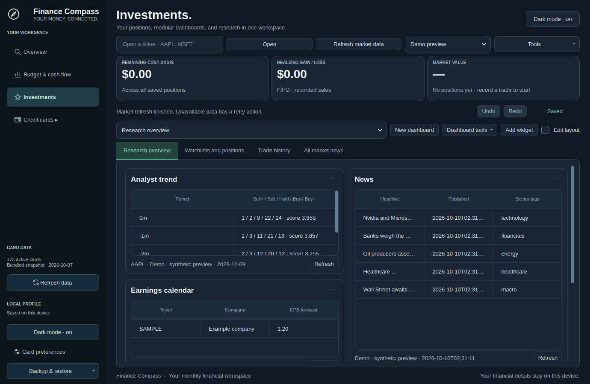
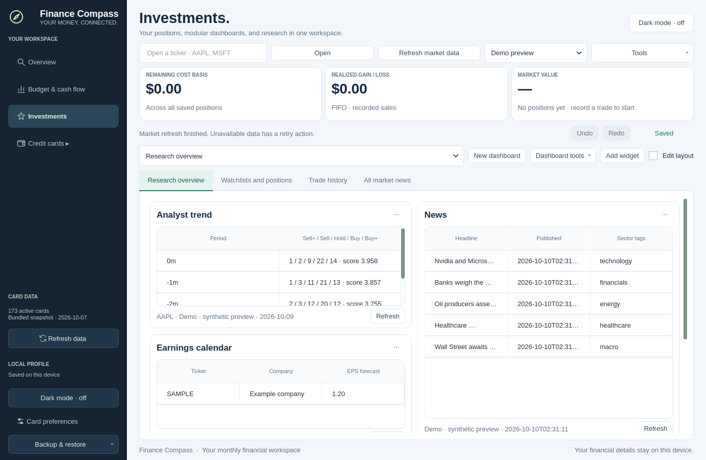
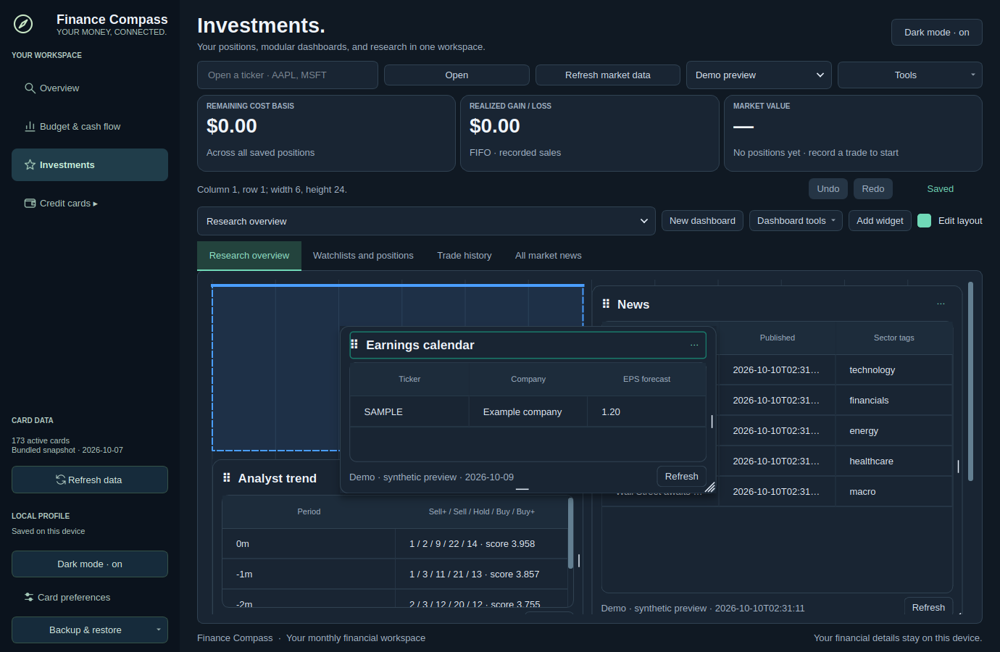

# Modular dashboard rebuild

## Phase 1: audit and design

The shipped UI is native Python/PySide6. `stocks_ui.py` uses a `QGridLayout` with shared rows, manually placed QWidget panes, custom `DragTitle` mouse handling, a floating thumbnail and slot swapping. There is no DnD library. The separate `stocks/` web project is not the active desktop pane renderer.

Failures are structural. Shared grid rows tie a short pane to its taller neighbor. Content minimum sizes and long footer labels can exceed the configured pane height. Slot swapping cannot express arbitrary placement or insertion. Some actions rebuild the full canvas, resetting component state. There is no edit/view separation, per-breakpoint geometry, coherent history or modular data/component contract.

The replacement uses the established Qt Graphics View scene system with `QGraphicsProxyWidget` for native interactive content. Browser libraries such as react-grid-layout and GridStack would require embedding a second runtime and rebuilding the native finance/data integration. Qt already provides transformed scene items, event forwarding, touch support, animation and widget clipping. A replaceable `LayoutEngine` handles pure grid geometry; the scene only renders its state.

New boundaries: `layout_engine` (12 columns, 10-pixel row units, collision repair and per-column compaction), `layout_store` (history, schema migration and save state), `grid_canvas` (scene interactions), `widget_frame` (header/body/footer and menu), `widget_registry` (component definitions), and `data_layer` (shared cached requests and subscription states). Each dashboard owns settings and a layout for lg/md/sm/xs. The page has one vertical scroll owner; pane tables, editors and overflowing bodies own only their content scrolling.

The old drag/slot-swap/shared-row implementations were deleted. Existing saved finance/trade/note data is migrated and preserved. Native Qt interaction tests replace the requested browser-only Playwright/Cypress runner because the active application has no DOM.

## Verification

Acceptance checks, migration coverage and phase commit details are recorded here as each phase completes.

Phase 2 introduces the replaceable geometry engine, independent Qt scene panes, mouse/touch/pen handles, edit/view separation, placeholder/insertion previews, animated collision displacement, three resize handles, keyboard pickup/drop and native accessibility announcements. Engine and native canvas interaction tests pass (9 tests). The frame owns a fixed header and footer with a clipped body; pane positions no longer depend on Qt shared grid rows. Qt reference: [proxy widgets](https://doc.qt.io/qtforpython-6/PySide6/QtWidgets/QGraphicsProxyWidget.html), [Graphics View](https://doc.qt.io/qtforpython-6/PySide6/QtWidgets/QGraphicsView.html).

Phase 3 replaces the investment renderer in Home, positions, trade history, market news, stock research and sector research. The old `DashboardCanvas`, shared `QGridLayout`, slot swaps, drag thumbnail, resize handle and inline widget rendering are removed. A registry defines all existing widget types, their sizes, configuration panels and data requirements. Components use shared cached, deduplicated requests and local subscriptions; only the affected widget updates when data arrives. Explicit loading/empty/error states, refresh actions, responsive tables, isolated render failures and a clipped source footer replace ambiguous unloaded labels. Version 1 IDs, configurations, notes and trades migrate into version 2 breakpoint layouts. Core engine, frame, registry, migration and financial model tests pass (20 tests).

Phase 4 adds a searchable, category-grouped gallery with live native previews, default-size hints and drag-to-canvas insertion. Dashboard tools provide duplicate/reorder, compaction/free-placement, density/gap/motion settings, reset, JSON export/import, saved templates and three starter templates. Widget duplicate, copy/move to another dashboard and removal all share undo/redo history. Six native workflow tests cover gallery selection and drag payloads, templates, dashboard actions, cross-dashboard moves and exact undo restoration. New blocks use the first free grid position; direct gallery drops push colliding neighbors away from the snapped anchor.

Phase 5 completes debounced optimistic saves, failure/retry feedback, unlimited session layout/configuration history, native accessibility announcements and reduced motion. Pointer previews retain the original page extent; edge scrolling cannot grow it or send the pane to a new bottom. Losing focus, changing tabs, resizing the viewport, releasing outside the canvas or pressing Escape cancels safely. Long provider messages and changing market summaries cannot resize the canvas during a gesture. Geometry/title-only changes retain components without rendering their data; table selections use stable record IDs, including trades with identical dates. Shared data subscriptions release unused requirements and preserve note cursors during refresh.

All registered components use exactly `Component(config, size, isEditing, onConfigChange)`. The registry resolves the shared data layer internally. Invalid cached chart values are caught before painting; constructor, configuration and render failures remain isolated to their frame. Existing currency labels, percentage units, watchlist sorting and saved table preferences remain available.

## Acceptance checks

The active application is native Qt, so the end-to-end runner uses `QTest` against real viewport pointer events, then closes and reopens the application against the same persisted profile. It does not simulate a browser DOM.

| # | Verified behavior | Evidence |
|---|---|---|
| 1 | Mouse header dragging commits snapped geometry and survives restart across Home, custom, shared/per-stock research and sector news contexts. | `test_widget_movement.py`: pointer drop/restart parametrization. |
| 2 | Beside drops create columns; before/after insertion pushes collisions without committed overlap. | Movement beside/between test; gallery beside-drop test; engine split/insertion and randomized repair tests. |
| 3 | Right, bottom and corner resizing snaps and respects minimum/maximum sizes; double-click fits content. | Movement edge/corner parametrization; engine clamping tests; touch/pen resize tests. |
| 4 | Per-column compaction closes the tall-neighbor gap. Header, clipped/scrollable body and footer remain separate at small sizes. | Engine independent-column compaction test; all-registry frame bounds test; light/dark screenshots below. |
| 5 | View-mode content/menu clicks cannot drag; edit-mode content cannot intercept the header gesture. Configure remains clickable without pickup. | Canvas view-mode test; real menu-click test; frame edit interaction checks. |
| 6 | Touch, pen and keyboard pickup, movement, resize, drop and Escape work; handles are focusable and moves announced. | `test_dashboard_input.py`: native viewport touch/pen parametrizations and keyboard/a11y test. |
| 7 | Undo/redo restores exact geometry and configuration snapshots; a new branch clears redo. Ctrl/Cmd shortcuts and removal toast are wired. | Persistence exact-history test; real Ctrl+Z/Shift+Ctrl+Z workflow; repeated drag/undo regression. |
| 8 | Constructor/runtime failures show a retry card without affecting neighbors; malformed charts cannot escape into painting. | Registry/runtime/chart isolation tests; canvas construction-error test. |
| 9 | Each dashboard stores lg/md/sm/xs layouts independently; xs uses one column. Version 1 retains IDs, config, notes and trades. Loaded bounds/overlaps are repaired and unknown types retained as placeholders. | Persistence breakpoint/repair tests; registry migration tests; native import/restart tests. |
| 10 | Gallery add/drop, duplicate, remove, move/copy to another dashboard, templates and dashboard changes are undoable. | `test_dashboard_tools.py` workflows with exact prior-state comparisons. |

Additional regressions cover fixed scene extent during 35 edge-scroll ticks, safe gesture cancellation, status/summary updates during a drag, deduplicated requests, stale/loading/empty/error states, failed save/retry and preservation of financial records during layout undo. A 21-widget/20-drag check verifies component reuse and bounded event processing. An offscreen measurement before final polish was approximately 0.88 ms median / 2.26 ms maximum per pointer-preview update; this measures Qt input processing, not physical-device frame rate.

Run all checks with:

```sh
QT_QPA_PLATFORM=offscreen .venv/bin/python -m pytest -q
```

Final result: **252 passed in 154.99 seconds**. Dark/light and active-drag previews were regenerated and inspected after the final geometry changes. Staged whitespace checks pass.

## Using the layout

Start with **Dashboard tools → Apply template → Investment overview**, or use **Add widget** and search for a block. Enable **Edit layout**, drag a header to the blue destination, and resize from an edge or corner. Disable edit mode to use tables and notes. The **⋯** menu contains configuration, rename, duplicate, move/copy, refresh, expand, lock and removal. **Undo** restores a removed block immediately. For keyboard editing, focus a header, press Space/Enter, use arrows to move or Shift+arrows to resize, then Space/Enter to drop or Escape to cancel.

Layouts save after 500 ms to the existing per-user native investment JSON store using atomic file replacement. Click **Failed – retry** if a write fails. Dashboard export/import and saved templates provide portable copies. **Dashboard settings** switches between gap closing and free placement and adjusts density, grid gap and motion.





## Scope and limitations

- Validation uses Linux offscreen Qt with generated mouse/touch/pen events. Physical touch hardware, OS screen readers and macOS/Windows input have not been manually exercised. A human ten-minute onboarding study has not been performed.
- Cross-dashboard movement uses **⋯ → Move to dashboard** or **Copy to dashboard**. Hovering a dragged pane over a tab is not implemented; the menu is the supported alternative in the requirements.
- Persistence uses the application's existing local per-user JSON backend. There is no remote account/database sync in this app. Undo history lasts for the session and concerns dashboard layout/configuration; it deliberately preserves newer trades and note text. Text editors retain their own undo.
- The four primary pages remain available. Up to 20 custom dashboards and 30 widgets per dashboard are supported. Small viewports use a single column and page scrolling; overflowing tables/editors scroll inside their allocated body.
- Financial/provider data availability remains dependent on the data source. Each widget now reports loading, missing, stale or failed data and provides a refresh/retry action. Screenshots use explicitly labeled synthetic demo data.

## Phase commits

1. `7c2d081` — audit and design diagnosis.
2. `47f8cf3` — independent layout engine, frame, drag and resize.
3. `712ec76` — registry, shared data layer and native widget migration.
4. `0c52bf4` — gallery, dashboard tools and templates.
5. Final persistence, accessibility and regression coverage commit — includes the acceptance checks above and the final full-suite result.
